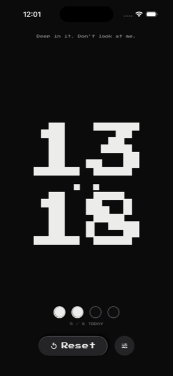
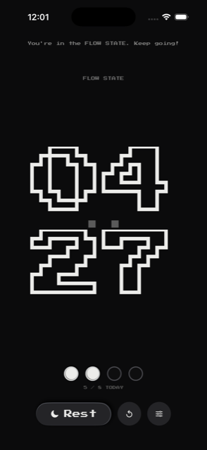
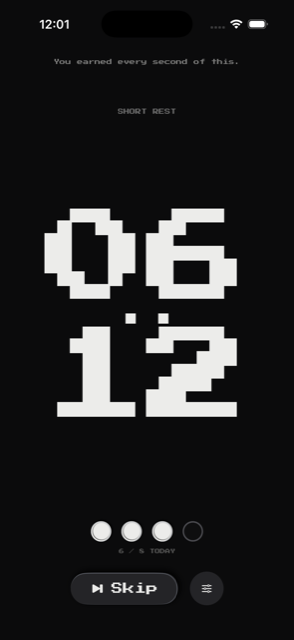
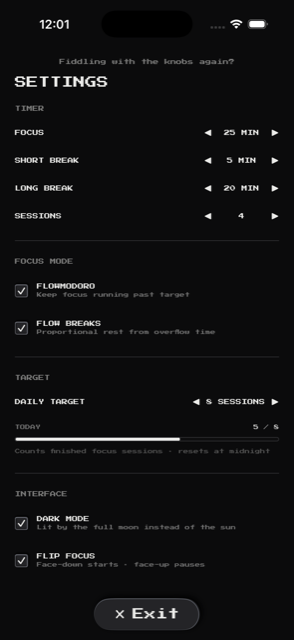
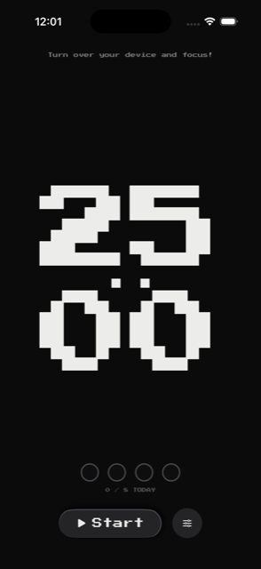
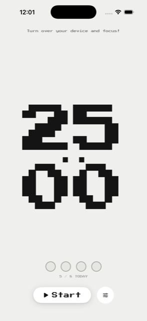
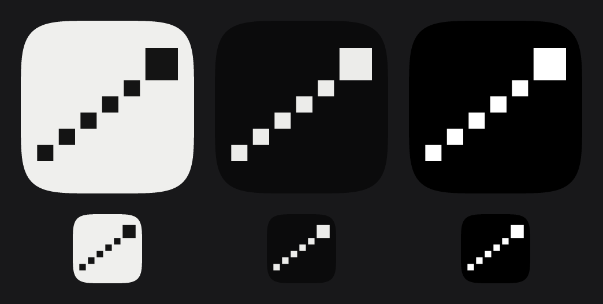

# Light Minute

A focus timer for iOS. Pomodoro when you want structure, flow state when you don't —
and when you overrun, the rest you've earned scales with the work you did.

Built in SwiftUI, rendered in a monochrome pixel style, with a timer large enough to
read from across the room.

---

## Screenshots

| Focus | Flow state | Rest | Settings |
|:---:|:---:|:---:|:---:|
|  |  |  |  |

Note the second frame: once you run past the target the digits go **hollow** and start
counting up instead of down. Same timer, inverted — you're no longer spending a budget,
you're building one.

Dark mode is the default. The two modes aren't a palette swap, they're the same surface
under a different light — the sun in one, the full moon in the other:

| Dark — moonlit | Light — sunlit |
|:---:|:---:|
|  |  |

---

## What it does

**Flowmodoro.** The focus timer doesn't stop at 25 minutes. If you're in it, keep
going — the clock keeps counting and nothing interrupts you.

**Proportional rest.** Rest is earned, not fixed. Overrun your focus target and the
break grows with it: short breaks accrue at 5:1, long breaks at 25:20. Work 30 minutes
against a 25-minute target and you get 6 minutes, not 5.

**Daily target.** Set how many focus sessions the day owes you. The count tracks
against it and resets itself at midnight — yesterday's effort doesn't carry forward,
and neither does yesterday's shortfall.

**Flip focus.** Put the phone face down and the timer starts. Turn it back over to
look at it and the timer stops — and MIKE has something to say about that.

**Live Activity.** Rest periods shrink into the Dynamic Island and keep running while
the app is backgrounded or killed. Timekeeping is anchored to wall-clock time, so
suspension, backgrounding and termination can't make the clock drift.

**Stays awake.** The screen won't lock while a timer is running.

**Light Week.** Optional, and off until you ask for it. Connect a
[Light Week](https://light-week.amanmehtos.workers.dev) account and every finished
focus block is written against the task you were working on — planned time, time
actually spent, how many times you stopped, and whether you saw it through. Opening a
task in Light Week hands it to the timer through
`com.lightminute.app:/focus?taskId=…`, and the task's name sits above MIKE so it is
obvious what the hour is being filed under.

Abandoned blocks are written too. A timer that records only its successes produces
statistics that flatter you.

Sessions are queued on the device first and sent afterwards, so a timer on the subway
is still a timer that counted. The queue survives relaunches and is only dropped once
the server has acknowledged it, which is safe because a push is idempotent on the op's
id.

Signing in is never required. With no account the timer is exactly the timer it was.

---

## Design

The interface follows **Diurnal UI**, which is not a light/dark theme in the usual
sense.

It's monochrome. There is no accent colour and nothing is colour-coded, so emphasis
has to come from contrast and elevation instead — a warning doesn't turn red, it
comes forward in ink.

The light is literal. Light mode is lit by the sun; dark mode by the full moon, which
sits at the sun's antipode — rising at sunset, peaking at midnight, setting at dawn.
The interface is treated as a flat surface seen from above, north up. Solar position
is computed from the NOAA low-precision algorithm, the light is placed at its real
compass bearing, and every shadow falls away from it: a low light casts long shadows,
a high one short.

One light state is computed per instant and broadcast through a SwiftUI
`EnvironmentKey`, so every shadow on screen agrees about where the light is.

Dark mode is the default.

Typography is **Press Start 2P**, registered at runtime via
`CTFontManagerRegisterFontsForURL`.

### The icon



A light minute is a distance — how far light travels in one minute — so the icon
measures one rather than illustrating a clock. Five equal marks climb the grid to
a larger lit head.

The marks are flat ink at full strength, not a fading trail. An earlier pass faded
them toward the ground, which looked better at 1024px and destroyed the idea at
29pt: you cannot count marks you cannot see. The recession is carried by the
rhythm of the gaps instead, so every mark survives at every size.

It is drawn on the same 32×32 cell grid as the timer face and ships in three
variants — sunlit, moonlit, and a grayscale master for iOS 18's tinted home
screen. All three are opaque on a flat Diurnal ground rather than transparent:
the system would otherwise composite its own gradient behind the dark and tinted
versions, and a gradient is the one thing a surface lit by a single light cannot
have.

The Dynamic Island shows the same mark rather than a separate glyph. It used to
show a moon, which was doing real work — the Live Activity only runs during a
break — but that slot is where the system says *which app is talking*, so it has
to match the icon; the break is still named in the expanded view. The mark is
drawn in SwiftUI from one shared cell table rather than imported as an image, so
the icon and the island can't drift apart, and the island's run is shortened to
three marks (two in the minimal presentation) because the full five turn to noise
below about 24pt.

> **Known deviation:** Diurnal UI specifies Libre Baskerville and IBM Plex Mono.
> This app deliberately uses Press Start 2P instead, to match the original Figma
> design. The light model and monochrome rules are followed; the typography is not.

---

## Layout

```
LightMinute/
├── LightMinute/
│   ├── LightMinuteApp.swift          App entry; registers the pixel font
│   ├── ContentView.swift             Root; injects the sky, owns scene phase
│   ├── Design/
│   │   ├── DiurnalLight.swift        Solar position → shadow geometry
│   │   ├── DiurnalElevation.swift    Shadow ViewModifier, generic over InsettableShape
│   │   ├── LightMinuteMark.swift     The app mark, drawn — shared with the widget
│   │   └── Theme.swift               Adaptive colours via UIColor(dynamicProvider:)
│   ├── Models/
│   │   ├── TimerState.swift          Settings + DailyProgress (midnight rollover)
│   │   ├── BoundTask.swift           The Light Week task a block is counted against
│   │   └── RestActivityAttributes.swift
│   ├── Services/
│   │   ├── RestLiveActivity.swift    ActivityKit wrapper
│   │   ├── LightWeekAuth.swift       OAuth 2.1 + PKCE; tokens in the Keychain
│   │   ├── LightWeekClient.swift     The /sync push, and the node id
│   │   └── FocusOutbox.swift         Durable queue — write first, send later
│   ├── ViewModels/
│   │   └── TimerViewModel.swift      Wall-clock anchored timekeeping
│   ├── Views/                        MikeHeader, PixelButton, PixelTimer,
│   │                                 SessionDots, Settings
│   ├── Info.plist                    CFBundleURLTypes only; the rest is generated
│   ├── Resources/
│   │   └── PressStart2P-Regular.ttf  The pixel typeface
│   └── Assets.xcassets/
│       └── AppIcon.appiconset        1024 masters: light, dark, tinted
└── LightMinuteWidget/
    ├── LightMinuteWidgetBundle.swift
    └── RestLiveActivityWidget.swift  Live Activity only — no home-screen widget
```

`Figma/` holds the original design exports.

---

## Building

**Requires** Xcode 26.2, iOS 17.0+, Swift 5 language mode.

**And a sibling checkout.** The project links `LightKit` as a local Swift package at
`../../light-work/apps/ios/LightKit`, so the
[light-work](https://github.com/amanmehtos/light-work) repo has to sit beside this one:

```
Documents/
├── Light Minute/      ← this repo
└── light-work/
```

LightKit holds the focus-session model, the hybrid logical clock and the sync wire
types, and both this app and Light Week for iOS depend on it. The alternative was to
copy the id and clock encodings into this repo, which is precisely the drift LightKit
exists to prevent — the padded base-36 clock has to sort identically on both sides or
conflict resolution quietly stops matching. Without the sibling checkout the package
fails to resolve and the build stops there.

1. Open `LightMinute/LightMinute.xcodeproj`.
2. Set your own team under Signing & Capabilities, and change the bundle identifier
   from `com.lightminute.app` — it's already taken.
3. Select the **`LightMinute`** scheme and run.

> **Pick the right scheme.** Running the `LightMinuteWidget` scheme fails with
> `Failed to show Widget … RequestDenied`. That's not a bug: the extension vends an
> `ActivityConfiguration` (a Live Activity) and no `StaticConfiguration`, so there is
> no home-screen widget for SpringBoard to place. The extension is embedded in the app
> automatically — never run it directly.

### On a free Apple ID

Workable, with two frictions:

- The app won't launch until you trust the certificate on the device:
  **Settings › General › VPN & Device Management**.
- Provisioning profiles last **7 days**, not a year. After that the app refuses to
  open until it's rebuilt and reinstalled.

---

## Screen Time blocking (removed)

Earlier versions shielded chosen apps with FamilyControls and ManagedSettings until
the day's target was met. **That code has been removed.** It is preserved in git
history at commit `199bf5d` (`LightMinute/Services/AppBlocker.swift`,
`LightMinute.entitlements`, and the BLOCK section of `SettingsView`).

It was cut because it could never run on this signing account, and a visible feature
that silently does nothing is worse than no feature.

Family Controls requires the `com.apple.developer.family-controls` entitlement, and a
**free Apple Developer Personal Team cannot enable that capability**. Adding it to
`CODE_SIGN_ENTITLEMENTS` doesn't fail at runtime — it fails the build and takes the
whole app down with it:

```
error: Provisioning profile "iOS Team Provisioning Profile: com.lightminute.app"
       doesn't include the Family Controls (Development) capability.
```

The constraint is the *account tier*, not the fact that it's a development build.
Development builds use Family Controls routinely; paid accounts get the development
entitlement automatically through Xcode, with no review. Apple's approval is only
needed to ship it to other people.

Worth knowing if it comes back: **an unauthorized `FamilyActivityPicker` does not
show an error.** It is a system view rendered out-of-process, so it presents for
anyone who asks and lists categories — Social, Games, Entertainment — but expanding
any of them shows zero apps, because iOS won't enumerate installed apps for an app
without Screen Time authorization. An empty accordion is the tell. A picker that
opens is not evidence that Family Controls works.

This was confirmed on hardware rather than inferred: a temporary diagnostic read the
app's own `embedded.mobileprovision` at launch, and the file pulled back over the
cable with `xcrun devicectl device copy from --domain-type appDataContainer` read
`status=notDetermined | entitlementInBinary=false`.

---

## Degraded and unbuilt

Honest list of what isn't finished.

| | |
|---|---|
| **App blocking** | Removed, not finished — see above. Bringing it back needs a paid membership, plus a `DeviceActivityMonitor` extension to re-arm the shield at midnight and a `ShieldConfiguration` extension so blocked apps show a Diurnal-styled screen rather than Apple's stock one. |
| **Weather** | Diurnal softens shadows under cloud. Not implemented — needs real weather data. |
| **Location** | Longitude is approximated from the device's UTC offset and latitude is fixed at 20°, so shadow bearings are roughly right and precisely wrong. |
| **Typography** | Press Start 2P instead of the system's Libre Baskerville / IBM Plex Mono — deliberate, see above. |
| **One sign-in per app** | Light Minute and Light Week sign in separately. A shared Keychain App Group would fix it, and a free Personal Team cannot enable App Groups. |
| **Reading from Light Week** | The app writes sessions and never reads. There is no task picker — a task arrives by link or not at all — because picking one needs `/sync/pull` and a local replica, which belongs in Light Week's own app. |
| **Icon packaging** | The built `Info.plist` carries `CFBundleIconName` nested inside `CFBundlePrimaryIcon` but not at the top level, where App Store Connect validation wants it. Harmless here — a free team can't submit anyway — but it would need sorting before any upload. `INFOPLIST_KEY_CFBundleIconName` does not fix it; that prefix only works for keys on Xcode's allowlist. |

---

## Credits

Design derived from the Light Minute Figma file. Typeface:
[Press Start 2P](https://fonts.google.com/specimen/Press+Start+2P) by CodeMan38,
SIL Open Font License.
